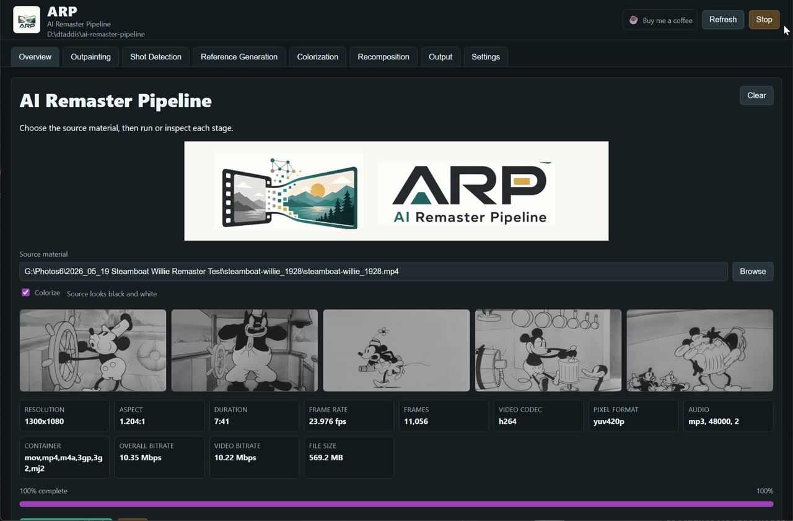
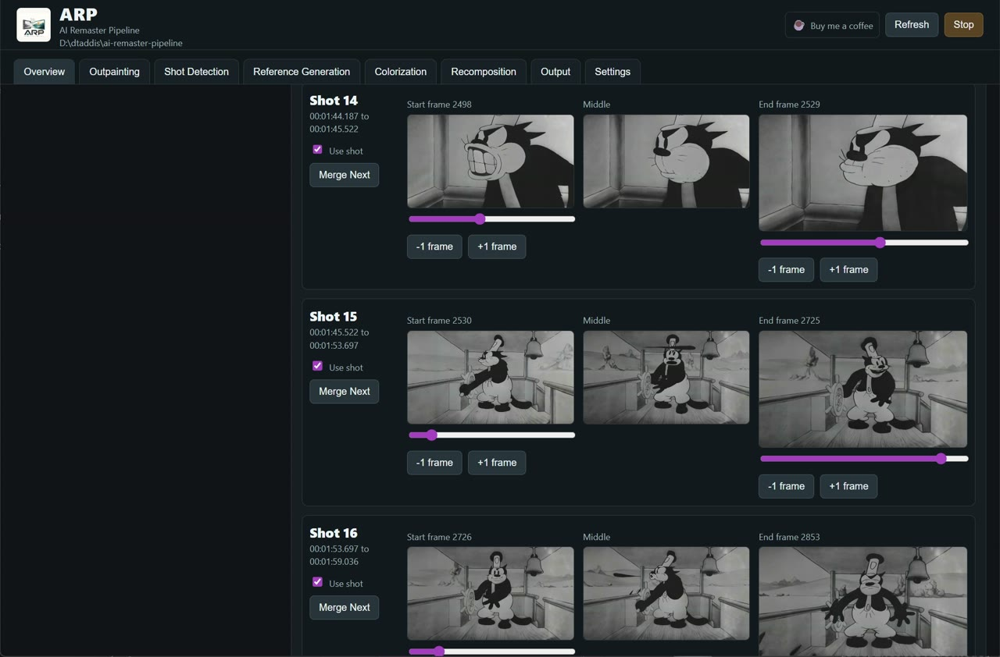
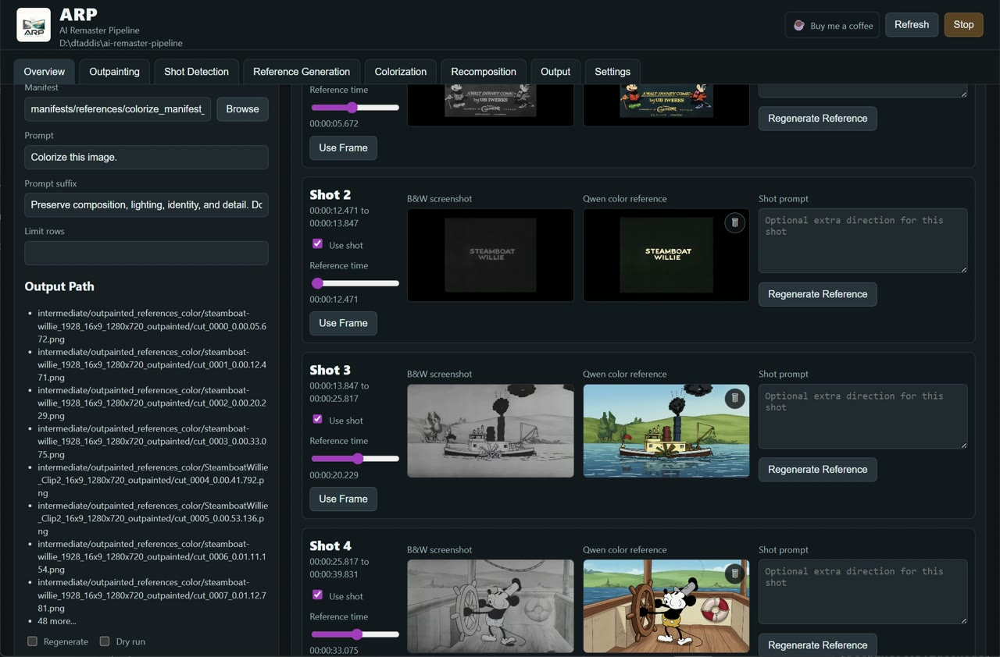
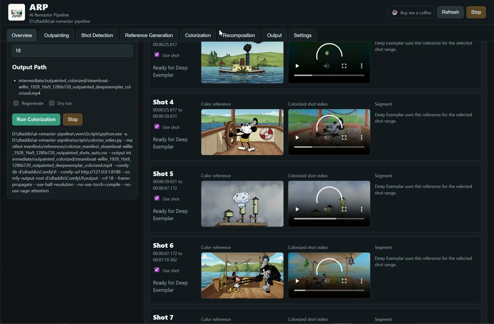
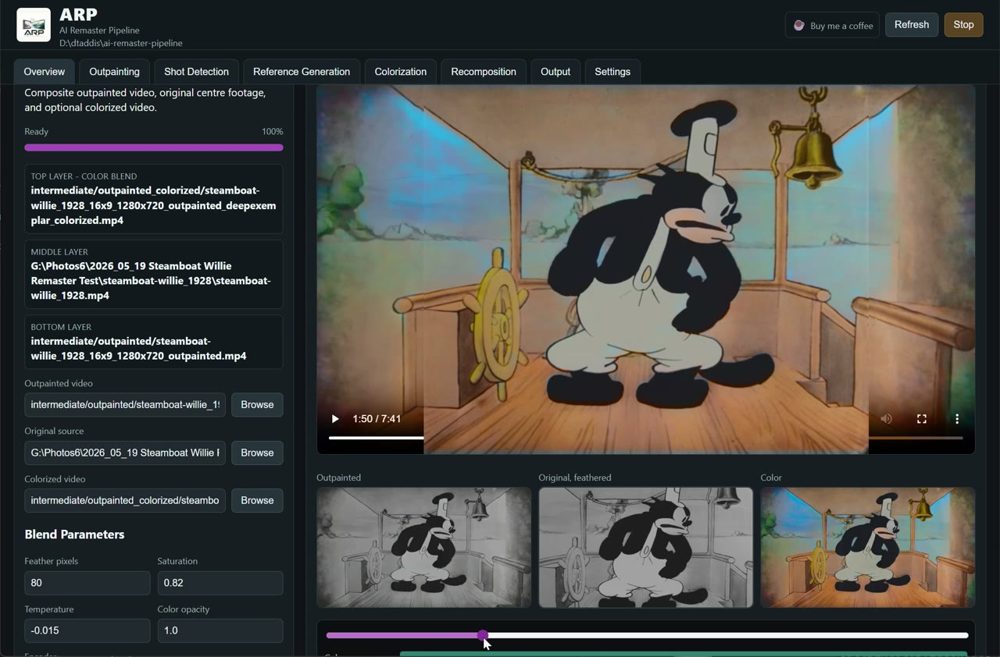
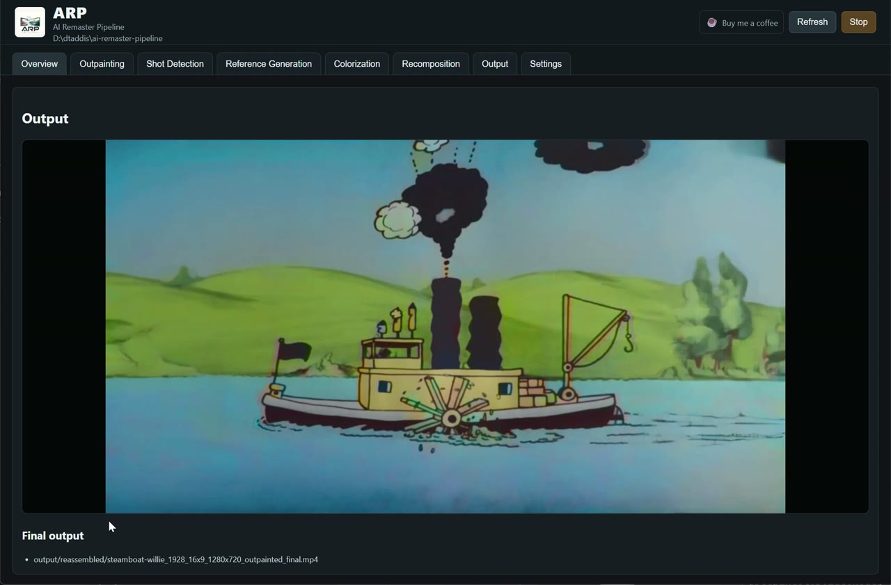

  

# ARP - AI Remaster Pipeline

A local GUI for remastering public-domain or licensed archive film with ComfyUI models: clean up, stabilise, outpaint to widescreen, colourise from reference stills, add a soundtrack and upscale. You run the whole job from one page, then inspect and adjust any stage where the AI needs steering.

Alpha software. Windows + NVIDIA is the supported path.

  

## Quick start

| | |
|---|---|
| **Needs** | Windows, NVIDIA GPU (24 GB recommended, 16 GB minimum), 64 GB RAM recommended, Python 3.13, Git, 150-250 GB free disk |
| **Install** | `install_windows.bat` (creates `.venv`, local FFmpeg, and a managed ComfyUI in `tools\comfyui`) |
| **Launch** | `launch_gui.bat` (macOS/Linux: `./launch_gui.sh`). The GUI starts ComfyUI in its own console if it isn't running. |
| **Update** | `git pull`, then re-run `install_windows.bat` (keeps models and outputs) |
| **Models** | Downloaded the first time a stage needs them. Prefetch with `install_windows.bat -DownloadModels`. |
| **Gated models** | Accept access on Hugging Face, then `hf auth login --force` |

1. **Overview:** browse to a video or numbered image sequence and tick the stages you want.
2. Click **Run Whole Remaster**.
3. Review each stage's tab: fix shot boundaries, pick and regenerate colour references, then rerun just that stage.
4. Watch the result on **Output**. Finished renders are in `output/reassembled/`.

## Cheat-sheet

| Stage | What it does | Main models | Tips |
|---|---|---|---|
| Clean Up | DeVignette, scratch repair, archive restoration | ProPainter, LTX 2.3 Dearchive IC-LoRA | Off by default. Dearchive outputs 720p. |
| Stabilization | Removes gate weave, one shot at a time | FFmpeg vid.stab | No auto-zoom, so framing never pulses. |
| Outpainting | Extends 4:3 to 16:9, 21:9, 9:16 and so on | LTX 2.3 + Oumoumad LoRA (default), LTX 2.5, Wan VACE, MiniMax H3 | Slowest stage. Paint guide frames to steer it. Keep 20 s chunks. |
| Shot Detection | Splits the film into shots | OpenCV cut and dissolve detector | Merge, split and nudge cuts. Mark fades. |
| Reference Generation | Colours one or more stills per shot | Qwen Image Edit 2511, Qwen-Image-2.1, OpenAI | Add extra references to long shots. Each reference has its own prompt and seed. |
| Colorization | Colours the video from the references | LTX Colorizer, CMNET2, ColorMNet, Deep Exemplar, OpenAI | LTX Colorizer can change shade as well as hue. Strength is set per shot and per reference. |
| Recomposition | Layers original, outpainted and colour together | FFmpeg / NumPy | Keeps the source centre intact and takes colour from the colour layer. |
| Create Audio Track | Adds music and sound effects | Stable Audio Open, MMAudio | Optional. Audio is copy-muxed. |
| Upscaling | Upscales to delivery resolution | FlashVSR, SeedVR2, LTX 2.5 Pixel Spatial, LTX 2.5 CQ Enhancer | Preview faces first. Per-shot AI strength blends with Lanczos. |

- **Compute:** any stage can run on a **RunPod** cloud worker instead of the local GPU (API key in Settings).
- **Licences:** ProPainter and Qwen-Image-2.1 are non-commercial. MiniMax H3 is region-restricted.

## Why it works this way

- **The original pixels win.** AI output never replaces source footage you already have. Recomposition puts the untouched source back in the centre and blends it into the outpainted edges. It takes colour from the colour layer and luminance only where you ask for it.
- **Stills decide colour, video models spread it.** Image models make far better colour choices than video colourisers, and a still is quick to review and redo. So colour is decided per shot on stills, and the video model only has to follow them. Long shots get several references, and Qwen 2511 is shown the shot's existing references so they stay consistent.
- **Shots are the unit of work.** References, strengths, fades and upscale strength all live on the shot list, so a fix touches only the shots it changes.
- **Fits a 24 GB card.** GGUF Q4 transformers, offloaded text encoders, chunked rendering and tiling keep each stage within one consumer GPU. Chunk lengths respect each model's frame-count rules.
- **Everything resumes.** Each output records a signature of its inputs and settings. Reruns reuse anything that still matches, down to the chunk, and re-render only what changed.
- **No needless generations.** Intermediates are 10-bit VP9 or FFV1 masters. Joins and trims are stream copies, and every join is checked for frame count. Neutral grey is fed to colourisers so Dearchive's tint can't leak in.

## Screenshots

| Shot Detection | Reference Generation |
|---|---|
|  |  |
| **Colorization** | **Recomposition** |
|  |  |

## More

- [User guide](docs/user-guide.md): installer options, every stage's settings, RunPod, folder layout and troubleshooting.
- [Model sources](docs/installer-model-sources.md), [Final composite](docs/final-composite.md), [LTX outpainting prep](docs/ltx-outpainting-prep.md), [Qwen workflow](docs/qwen-image-edit-workflow.md).
- Backend scripts can be run directly from `wrappers/`. The GUI shows each stage's command before running it.

## Licensing

ARP is orchestration software. It grants no rights to source films, model weights, LoRAs or third-party nodes, so check each licence before use.
